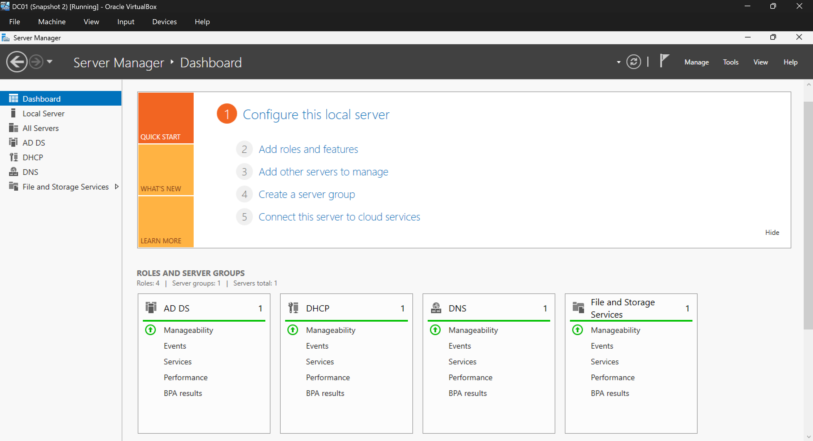
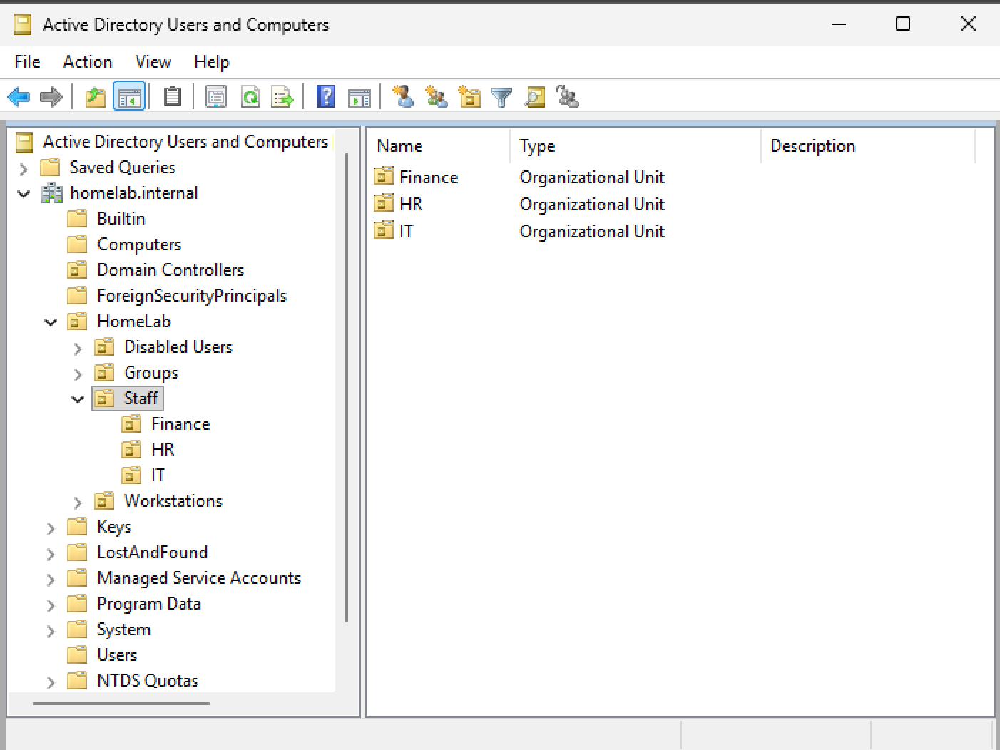
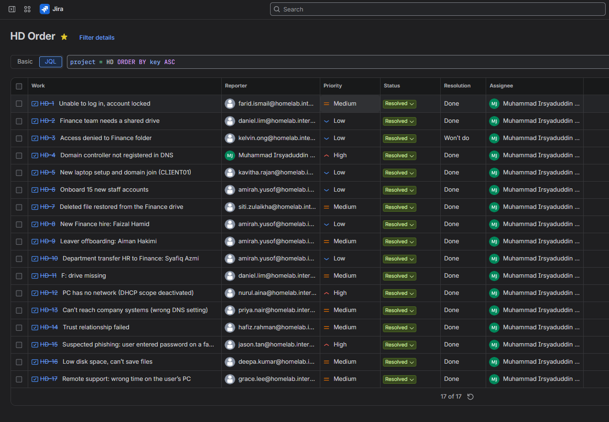
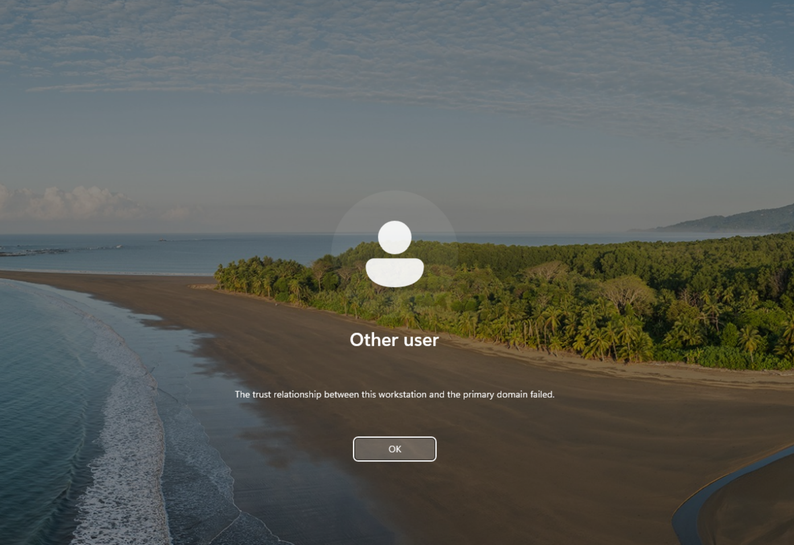
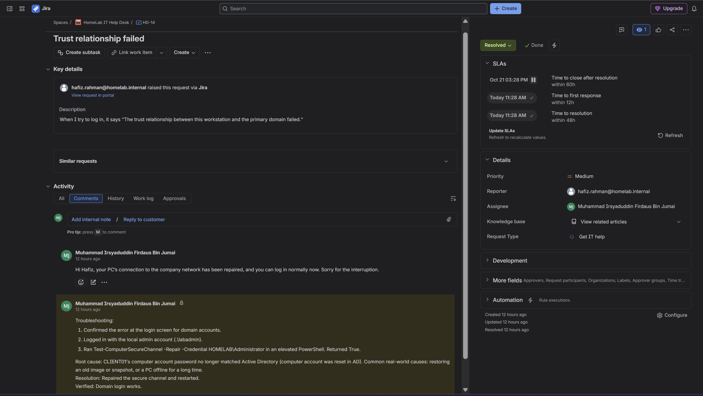
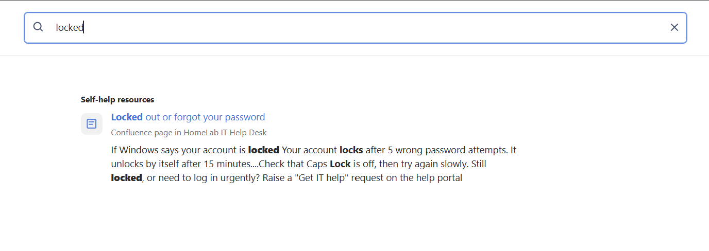

# Windows Server Home Lab: IT Help Desk Simulation

I built this lab on my own PC to practise the work a junior IT support role involves, after completing the Google IT Support Professional Certificate. It is a small company network with a Windows Server 2025 domain controller, a domain-joined Windows 11 PC, and a Jira Service Management help desk where I logged and resolved 17 tickets.

The staff and their requests are made up. Every fix in the tickets was done for real in the lab. To create realistic problems I broke things on purpose, for example by deactivating the DHCP scope or resetting a computer account to cause a domain trust failure.

Built in October 2026.

## Lab overview

| Component | Details |
|---|---|
| Host | Windows PC, Intel i5-10400F, 16 GB RAM, Oracle VirtualBox 7.2 |
| DC01 | Windows Server 2025 Standard (evaluation), 4 GB RAM, 2 vCPU, static IP 10.10.10.10 |
| CLIENT01 | Windows 11 Enterprise (evaluation), 4 GB RAM, 2 vCPU, IP address from DHCP |
| Network | VirtualBox NAT Network "LabNet", 10.10.10.0/24, gateway 10.10.10.1, VirtualBox DHCP turned off |
| Domain | homelab.internal (NetBIOS name HOMELAB) |
| Help desk | Jira Service Management (Free plan) with a Confluence knowledge base |

I used `homelab.internal` as the domain name because ICANN reserved `.internal` for private networks in 2024, so it will never clash with a real public domain.

## What I set up

### Active Directory, DNS and DHCP

- Promoted DC01 to the first domain controller of a new forest, `homelab.internal`, with DNS installed.
- DNS: DC01 uses itself for DNS, forwards internet lookups to 8.8.8.8 and 1.1.1.1, and has a reverse lookup zone for 10.10.10.0/24.
- DHCP: a scope called "LabNet Clients" hands out 10.10.10.100 to 10.10.10.200, along with the gateway, DNS server and domain name. The DHCP server is authorised in Active Directory.
- Joined CLIENT01 to the domain and moved its computer account into its own OU.

### Users, groups and OUs

Everything I created sits under a top-level OU called HomeLab. Staff accounts are split into IT, Finance and HR OUs, and there are separate OUs for the security groups (SG-IT, SG-Finance, SG-HR), workstations and disabled accounts.

- Created the first 15 staff accounts with a PowerShell script that reads a CSV file ([scripts/New-LabUsers.ps1](scripts/New-LabUsers.ps1) and [scripts/users.csv](scripts/users.csv)). Each user is placed in their department OU, added to the matching security group, and has to change their password at first sign-in.
- The script asks for the temporary password when it runs, so no password is saved in the script or the CSV. It skips accounts that already exist, so it is safe to run again.
- Single requests after that (a new starter, a leaver, a department transfer, password resets) were done in Active Directory Users and Computers, the way a help desk normally handles them. By the end the domain had 16 staff accounts, one of them disabled after offboarding.

### Group Policy

| GPO | Linked to | What it does |
|---|---|---|
| Default Domain Policy | `homelab.internal` | Minimum password length of 10 with complexity on. Accounts lock for 15 minutes after 5 wrong attempts. |
| Map Finance Drive | `HomeLab\Staff` | Maps F: to `\\DC01\Finance`, only for members of SG-Finance (item-level targeting). |
| Enable Remote Desktop | `HomeLab\Workstations` | Allows Remote Desktop connections and opens the firewall rule, so IT can support PCs remotely. |

### File share and file recovery

- Shared `C:\Shares\Finance` on DC01 as "Finance", with access-based enumeration on so people only see folders they can open.
- NTFS permissions: inheritance off, the Users group removed, and SG-Finance given Modify. The share permissions stay at the default and NTFS controls access.
- Turned on Shadow Copies for DC01's C: drive, so deleted or overwritten files on the share can be recovered through Previous Versions.

## Help desk tickets

All 17 tickets are in Jira Service Management. For each one I did the work in the lab first, then logged it with:

- the reporter (a fictional staff member), request type and priority
- an internal note for IT covering what I checked, the root cause, the fix and how I confirmed it worked
- a reply to the user in plain language
- a resolution: Done, or Won't do when a request was refused

I set priority from impact (how many people are affected) and urgency (how quickly things get worse or how time-sensitive the request is), the way ITIL-based service desks do. High means many users are affected or there is a security risk. Medium means one person's work is affected, or a request is time-sensitive, such as removing a leaver's access. Low is for requests where nobody is blocked. That gave 3 High, 8 Medium and 6 Low.

| Ticket | Request | Priority | Resolution | What I did |
|---|---|---|---|---|
| HD-1 | Account locked out | Medium | Done | Confirmed the lockout in ADUC, then reset the password with "Unlock the user's account" and "User must change password at next logon" ticked. |
| HD-2 | Finance team needs a shared drive | Low | Done | Created the Finance share, set NTFS permissions for SG-Finance, and mapped it as F: with a GPO. |
| HD-3 | Access denied to the Finance folder | Low | Won't do | The user is in HR, not Finance. Access is restricted by design, so I told the user it needs the Finance Manager's approval first. |
| HD-4 | Domain controller not registered in DNS | High | Done | `dcdiag` showed Event 5774. Re-registered the DC's DNS records and confirmed the SRV record with `nslookup`. |
| HD-5 | New laptop setup and domain join | Low | Done | Installed Windows 11, checked it got a DHCP lease, joined it to the domain and moved it to the Workstations OU. |
| HD-6 | Onboard 15 new staff | Low | Done | Built the OUs and security groups, then created the accounts from a CSV with a PowerShell script. |
| HD-7 | File deleted from the Finance drive | Medium | Done | Recovered the one file from a shadow copy through Previous Versions, without rolling back the whole folder. |
| HD-8 | New Finance hire | Low | Done | Copied an existing Finance user in ADUC so the new account got the same group access. |
| HD-9 | Leaver offboarding | Medium | Done | Disabled the account, reset the password, removed group access, added the ticket number to the description and moved it to Disabled Users. |
| HD-10 | Transfer from HR to Finance | Low | Done | Moved the account to the Finance OU, swapped SG-HR for SG-Finance and confirmed F: appeared after the user signed in again. |
| HD-11 | F: drive missing | Medium | Done | `gpresult /r` showed the GPO applied but SG-Finance missing from the user's groups. Added the user back to the group. |
| HD-12 | PC has no network | High | Done | The PC had a 169.254.x.x address. Found the DHCP scope deactivated, activated it and renewed the lease. |
| HD-13 | Can't reach company systems | Medium | Done | DNS had been set by hand to 8.8.8.8. Set it back to automatic so the PC uses the domain controller for DNS again. |
| HD-14 | Trust relationship failed | Medium | Done | Signed in with the local admin account and repaired the secure channel with `Test-ComputerSecureChannel -Repair`. |
| HD-15 | Suspected phishing | High | Done | Reset the user's password and forced a change at next logon. Noted the Microsoft 365 steps this lab can't cover. |
| HD-16 | Low disk space | Medium | Done | Found a large old file using Storage settings and File Explorer search, deleted it with the user's agreement and ran Disk Cleanup. |
| HD-17 | Clock showing the wrong time | Medium | Done | Connected to the PC over Remote Desktop from DC01 and corrected the time zone. |

## Knowledge base

I wrote five knowledge base articles in Confluence and linked them to the help desk.

| Article | Audience |
|---|---|
| Locked out or forgot your password | Staff, shown in the help portal |
| Unlock an account and reset a password | IT only |
| Onboard a new employee | IT only |
| Offboard a leaver | IT only |
| Mapped network drive missing or access denied | IT only |

The staff article sits in an external knowledge base, so staff can find it in the help portal before raising a ticket. The four IT procedures sit in an internal knowledge base that staff can't see. Copies of all five are in [knowledge-base/](knowledge-base/).

## Problems I ran into

**dcdiag errors on the new domain controller.** Right after promotion, `dcdiag /q` failed the DFSREvent and SystemLog tests. Most of the events were one-time startup noise: the first RID pool request, the initial SYSVOL setup, and Secure Boot certificate updates on a VM with Secure Boot turned off. The one that mattered was Event 5774, which meant the DC couldn't register its DNS records. Without them, other computers can't find the domain. I re-registered them with `ipconfig /registerdns` and a Netlogon restart, then confirmed the `_ldap._tcp` SRV record with `nslookup`. This became ticket HD-4.

**Knowledge base articles wouldn't save.** Jira showed "We're having trouble creating the article", and Confluence said I didn't have permission to create pages. Atlassian's support article for that error pointed to Confluence permissions. My account had no Confluence role, so I added one in Atlassian Administration and then checked billing to make sure the site was still on the Free plan. I gave myself the App admin role because it was quickest in a one-person lab. In a real company I'd assign the lowest role that does the job.

**The trust error didn't show up at first.** When I recreated the HD-14 problem to get a screenshot, I reset CLIENT01's computer account but could still sign in as the domain administrator. Windows had used that account's cached credentials instead of checking with the domain controller. The error only appeared when I signed in as a user who had never logged on to that PC, so Windows had to contact the domain controller. The repair command then failed the first time with "Administrator rights are required", because I had opened PowerShell without Run as administrator. In a real office this means a user with cached credentials can keep working after the trust breaks, and the first sign is often a new user who can't log in.

**CLIENT01 lost its network after restoring snapshots.** After I restored both VMs from snapshots, CLIENT01 had a 169.254.x.x address and couldn't reach anything, so domain sign-ins failed with "your domain isn't available". The DHCP server on DC01 wasn't handing out addresses. I fixed it in the DHCP console, ran `ipconfig /renew` on CLIENT01, and took a new snapshot of both VMs so I had a clean restore point.

## Limitations

- There is no Microsoft 365 tenant, so email, Teams, MFA and licensing tickets aren't covered. The offboarding and phishing tickets list the Microsoft 365 steps I would add.
- No physical hardware or printers are involved.
- Windows Server and Windows 11 run on Microsoft's free evaluation licences.
- There is only one domain controller, so there is no redundancy.

## Files

The user creation script and CSV are in [scripts/](scripts/), the knowledge base articles in [knowledge-base/](knowledge-base/), and more screenshots in [screenshots/](screenshots/).

## Tools used

Oracle VirtualBox, Windows Server 2025, Windows 11 Enterprise, Active Directory Domain Services, DNS, DHCP, Group Policy, PowerShell, Jira Service Management, Confluence
